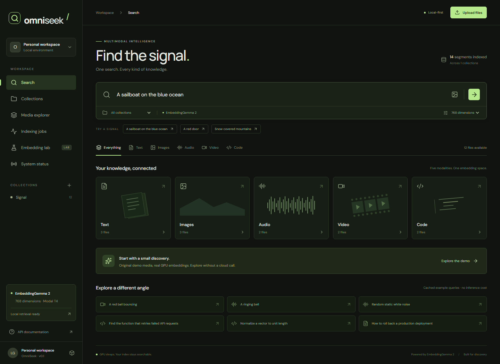
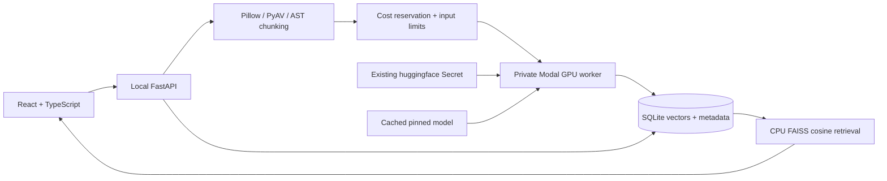
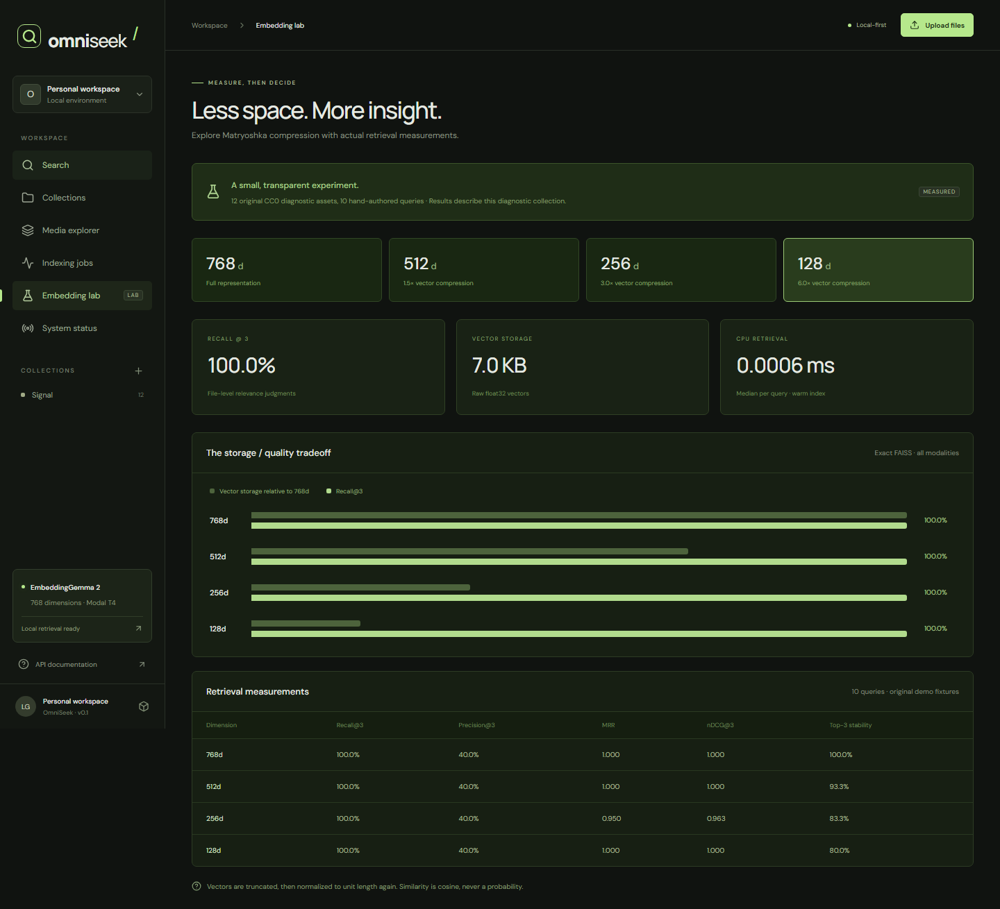

# OmniSeek

**Find the signal.** Semantic search across text, images, audio, video and code,
powered by EmbeddingGemma 2 and on-demand Modal GPUs.

OmniSeek brings a collection of files into one embedding space. Describe a scene,
look for a function, match a sound or search with an image. Results keep the
original file, code location and media timestamps close at hand. The frontend and
API run locally; GPUs wake only for explicitly enabled inference. Existing vector
indexes remain searchable on CPU after cloud workers stop.



## What works

| Input | Indexing | Search and preview |
| --- | --- | --- |
| Text | UTF-8 documents, bounded overlapping chunks | Natural-language retrieval, source preview |
| Code | Python AST boundaries; line chunks for other languages | Code query instructions, file and line spans |
| Images | Native image embeddings | Text-to-image and image-query retrieval |
| Audio | Native audio embeddings, mono 16 kHz, 10-second windows | Text-to-audio retrieval, timestamped playback |
| Video | Native video inputs from sampled frame sequences, 10-second windows | Text/image-to-video retrieval, coarse clip playback |

The app includes collection creation/deletion, bounded uploads, duplicate detection,
file removal, indexing jobs, rebuilds, media browsing, modality filters, cosine
scores, an Embedding Lab and a system/cost view backed by stored data. It uses a
real FastAPI backend; the included demo contains original CC0 assets and real
GPU-recorded vectors. No random or keyword-based “semantic” fallback is used.

## Run the free local demo

Prerequisites: Python 3.12, [uv](https://docs.astral.sh/uv/), Node.js 22.12+.
From the repository root:

```sh
uv sync --locked
npm --prefix frontend ci
npm --prefix frontend run build
uv run python -m omniseek_multimodal.cli demo
uv run python -m omniseek_multimodal.cli serve
```

Open **http://127.0.0.1:8000**. The same server serves the frontend and API.
OpenAPI: **http://127.0.0.1:8000/docs**. No Modal login, local CUDA, model download
or GPU spending is required to explore the recorded demo.

Try these exact cached queries:

- “A sailboat on the blue ocean” — prose, illustration and animation.
- “A red ball bouncing” — short video with a timestamped match.
- “A ringing bell” — synthesized audio.
- “Find the function that retries failed API requests” — Python source.

Image queries using an already indexed demo image also work locally. Arbitrary
new text/image queries require model inference. The UI labels cached embeddings
and reports when cloud access is disabled. For development, run
`npm --prefix frontend run dev` alongside the API; Vite proxies API calls.

## Enable real indexing

Use an existing authenticated Modal profile and a Modal Secret named exactly
`huggingface`. Its verified key is `HF_TOKEN`; the token stays in Modal. No public
GPU endpoint is deployed.

PowerShell:

```powershell
$env:OMNISEEK_ALLOW_CLOUD = '1'
$env:OMNISEEK_GPU = 'T4'
uv run python -m omniseek_multimodal.cli serve
```

POSIX:

```sh
OMNISEEK_ALLOW_CLOUD=1 uv run python -m omniseek_multimodal.cli serve
```

Create a collection, upload files, then press **Index**. Uploading alone never
launches a GPU. Indexing and uncached query embedding are billable, protected by
the local ledger. T4 is the default after successful full-model execution; L4 is
also verified. Read the [local deployment guide](docs/deployment/local.md) for
limits, settings, commands and troubleshooting.

## Architecture



The checkpoint is `google/embeddinggemma-2`, revision
`914f7f89142e33e77833254d9c9b90c3cef7303b`. Sentence Transformers generates a common
768-dimensional representation. Required encoders are selected automatically:
text only, text/vision, text/audio or full. The small compatibility experiment
measured identical vectors between selective and full configurations on its test
inputs. T4 uses float32; L4 uses bfloat16. Float16 is avoided.

SQLite atomically stores canonical float32 vectors with collection, file, segment,
line/timestamp, model revision, dimension and index version. FAISS `IndexFlatIP`
loads these vectors into a CPU index for search. Canonical persistence does not
depend on keeping a GPU alive. The implementation reconstructs small FAISS indexes
in memory rather than persisting an unsafe Python object. Model/version mismatches
require explicit rebuilding. See the [architecture](docs/architecture/system.md).

## Measured research



The diagnostic evaluation uses **12 original files, 14 segments and 10 explicit
relevance judgments**. It evaluates file-level Recall@3, Precision@3, MRR, nDCG@3,
ranking stability, storage, build time and warm query latency, including exact
FAISS versus HNSW.

| Dimension | Raw vectors | Recall@3 | MRR | nDCG@3 | Top-3 overlap with 768d |
| ---: | ---: | ---: | ---: | ---: | ---: |
| 768 | 42 KiB | 1.000 | 1.000 | 1.000 | 1.000 |
| 512 | 28 KiB | 1.000 | 1.000 | 1.000 | 0.933 |
| 256 | 14 KiB | 1.000 | 0.950 | 0.963 | 0.833 |
| 128 | 7 KiB | 1.000 | 1.000 | 1.000 | 0.800 |

Truncation is followed by L2 renormalization of query and corpus. The canonical
database retains full vectors; the table measures compressed arrays. A 256d
mountain/noise ranking inversion illustrates why Recall@3 alone is insufficient.
This deliberately simple synthetic corpus does not establish general retrieval
quality or a universal compression recommendation.

Real full-model runs generated 36 embeddings in **10.69 s on T4 float32** and
**10.91 s on L4 bfloat16**, including model loading inside the container. These
single runs do not establish a general GPU speed difference. Additional experiments
measure selective encoder compatibility, prompt ablation, batches of 1/2/4/8,
native MP4 versus windowed video, a scene-difference heuristic and audio granularity.
The [research report](docs/research/multimodal-retrieval.md) contains methodology,
mathematics, actual failures and limitations. Machine-readable measurements and
real embedding fixtures are in [experiments/results](experiments/results).

Reproduce CPU evaluation without spending credits:

```sh
uv run python -m omniseek_multimodal.cli evaluate
```

## Cloud costs

Modal rates checked on 2026-10-24: **T4 $0.59/h, L4 $0.80/h**, plus CPU, memory,
egress and storage. Workers have a 600-second timeout, 300-second startup limit,
one container, zero retries and no warm instances. A persistent model-cache volume
avoids downloading weights for every call.

The final nine app receipts totaled **$0.05357 gross**, with **$0.00 net workspace
billing after credits** at the recorded snapshot. This includes live API validation
and the final locked-image GPU test; details are in [costs.json](experiments/results/costs.json).
These are provider-reported charges, separate from conservative local reservations.
Cache-volume storage continues independently; the ledger reserves $0.50 for it.

The local operational ceiling is $8 inside a $10 authorization. Reservations
include failures and margins, and are never reclaimed based on optimistic runtime
estimates. Estimates and timeouts cannot guarantee a provider-level billing cap.
The private-repository CI uses one CPU-only Linux job with a 15-minute limit;
its worst-case runner charge is $0.09 at the verified $0.006/minute rate, before
any included minutes. It has no GPU credentials or persistent dependency cache.

```sh
make cost-report
make benchmark-dry-run
# Explicitly billable, individually bounded commands:
make gpu-smoke-test
make gpu-benchmark
make gpu-research
```

Equivalent `uv run python -m omniseek_multimodal.cli <command>` commands work on
Windows without Make. Current prices and workspace billing are checked before
cloud launches. No GCP infrastructure or public unauthenticated service is created.

## Validation

```sh
uv run pytest
uv run ruff check src modal_apps scripts tests
uv run ruff format --check src modal_apps scripts tests
uv run mypy
npm --prefix frontend run lint
npm --prefix frontend run build
npm --prefix frontend test
```

Offline tests cover vector math, index persistence, actual recorded cross-modal
search, prompts, timestamps, corrupt files, duplicates, API errors, origin checks,
secret non-disclosure and GPU failures. Playwright tests exercise the real backend,
uploads, collection management, media playback controls, dimensions, all navigation
views and mobile layout. Screenshots are captured from the running application.
GPU tests are excluded by default and CI launches no GPUs. An explicit
`uv run python scripts/live_validation.py` checks real GPU indexing through the API,
a new query and persistence after restarting with cloud access disabled.

## Scope and next experiments

- Local single-user software; no public hosting, accounts or shared-access controls.
- 20 MiB/file, 100 files/collection, 180 seconds/recording and 128 segments/job.
- Audio embeddings are not speech transcription; video indexing uses visual frames.
- Fixed temporal windows provide coarse matches. Scene detection is research-only.
- UTF-8 files and the documented image/media formats are supported; PDF/OCR is not implemented.
- Python has AST-aware chunks; other supported source languages use line windows.
- New embeddings pay a cold-start cost. Small FAISS indexes are rebuilt in CPU memory per search.
- No durable distributed queue, automatic retry, calibrated confidence or production-scale benchmark.

Next work: independent natural-media datasets and harder negatives, interval-level
judgments, repeated GPU trials, per-modality compression selection, cached CPU
indexes and a durable job queue. Storage boundaries can later target object
storage or a managed database without coupling vector retrieval to a live GPU.

## Sources and licenses

[EmbeddingGemma 2 model card](https://huggingface.co/google/embeddinggemma-2) ·
[Official integration guide](https://ai.google.dev/gemma/docs/embeddinggemma/multimodal-embeddinggemma-with-sentence-transformers) ·
[Modal pricing](https://modal.com/pricing) ·
[Matryoshka Representation Learning](https://arxiv.org/abs/2205.13147) ·
[FAISS research](https://arxiv.org/abs/1702.08734).

See [NOTICE](NOTICE) for dependency attribution and
[assets/demo/LICENSE.txt](assets/demo/LICENSE.txt) for the original CC0 assets.
