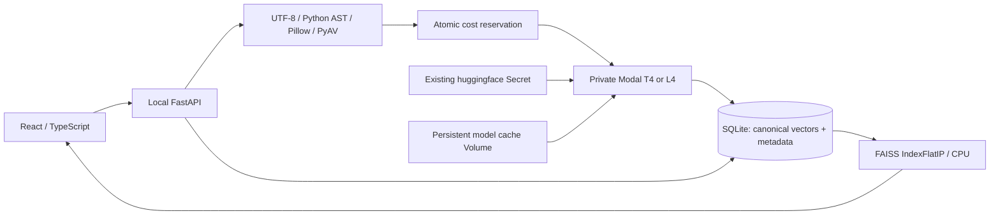

# System architecture

OmniSeek runs a single local FastAPI process with a React client. It sends bounded
embedding work to private, temporary Modal functions. CPU retrieval continues
after the functions and GPU containers terminate.

## Data and compatibility

Collections own files, and files own segments. Foreign keys cascade deletion.
Originals use random IDs as disk names, never client paths. SQLite stores each
768-dimensional normalized float32 vector alongside segment text, line numbers or
start/end seconds, collection/file identity, model revision, and index version.
Each file's replacement vectors are committed together; a failed GPU call keeps
the previous index. Multi-file replacement is atomic per file, rather than per
collection. WAL allows reads while jobs update metadata.

The on-disk canonical representation is SQLite, not a pickle or serialized GPU
object. Search reloads those vectors and builds a small FAISS inner-product index
in memory. This incurs CPU build work but never requires model inference. A future
large-collection service can cache these indexes with an invalidation generation.
Index-version or model-revision mismatches fail closed and require reindexing.
Changing the UI dimension projects both query and corpus to the same leading
coordinates and renormalizes both. It does not shrink the canonical SQLite file.

## Input processing

| Modality | Representation | Location |
| --- | --- | --- |
| Text | UTF-8, 48-line chunks, 8-line overlap; long lines bounded to 6,000 characters | Line span |
| Code | Python top-level AST boundaries, then bounded chunks; other languages use line windows | File + line span |
| Image | Decoded RGB, resized to at most 768 pixels per side | Original file |
| Audio | PyAV decode, mono 16 kHz float32; nonoverlapping 10-second windows | Start/end seconds |
| Video | One sampled RGB frame per second, 10-second windows, passed through the model's video input | Coarse start/end seconds |

Audio embeddings are native audio representations. No transcription or transcript
search is implemented. Video indexing uses sampled visual content; it does not
index the video's soundtrack. The research runner also exercises native MP4
decoding and a simple scene-difference heuristic.

Uploads are at most 20 MiB per file, 100 files per collection, 180 seconds per
recording, 128 segments per job, and 20 million pixels per image/frame. An ASGI
body limit also handles requests without Content-Length. Bad extensions, empty
files, binary text, corrupt decodes and overlong media receive structured errors.
Content hashes make duplicate uploads within a collection idempotent.

## Local trust boundary

The server binds to 127.0.0.1. Host and write-origin checks block common browser
drive-by requests and DNS rebinding. No public deployment, multi-user identity,
shared tenancy or authorization system is provided. Do not expose this API to the
Internet; all files belong to the trusted local user. Originals use explicit
content types and nosniff, and source/text files are served as plain text. Byte
ranges support media seeking. React escapes text previews.

Modal calls use the local authenticated SDK. There is no public GPU HTTP endpoint.
The existing `huggingface` Secret is injected only into model functions. The
preflight returns the detected variable names and a success boolean; never values.
The verified variable is `HF_TOKEN`. Secret values, environment dumps and provider
credentials are absent from the API and repository.

The model service is packaged inside `src/omniseek_multimodal/modal_apps` so CLI
and API worker imports work regardless of the caller's current directory. The
root `modal_apps` files are small repository entrypoints for the same definitions.

## Jobs and cost controls

One in-process indexing job and one cross-process cloud reservation run at a time.
Modal is limited to one container per function, zero warm containers, zero retries,
a 600-second execution timeout and a 300-second startup timeout. Containers are
single-use and terminate after each request. No deployment command is required.
In-memory background work is intentionally small: a restart marks unfinished jobs
failed; it does not resume or automatically repeat paid work.

The ledger reserves a conservative job envelope before launch, retains it after
failures, and enforces an $8 operational ceiling inside the $10 authorization.
Current provider rates and billing summary are read before cloud work. Estimates
include bounded compute, build overhead, egress and a $0.50 storage allowance.
They cannot enforce a provider-level billing cap or include unrelated workspace
activity. A cached model volume remains after experiments; remove it explicitly
when no longer useful. Existing unrelated Modal resources are never modified.
